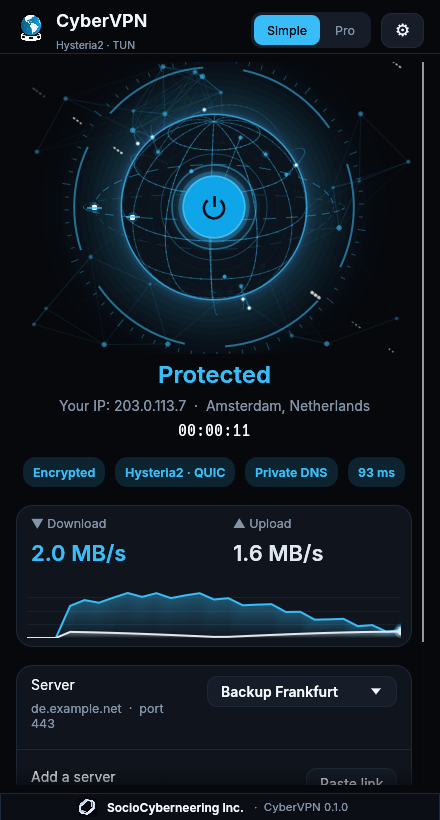
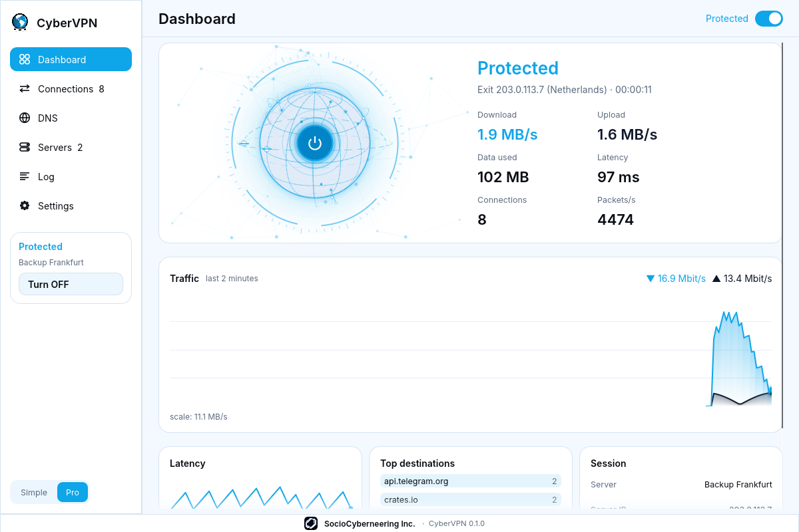

<div align="center">


# CyberVPN

**A fast, beautiful Hysteria2 VPN for Linux and Windows, written in Rust.**
One button. A tray icon. No root needed.

**English** · [Русский](README.ru.md)

[](https://github.com/sociocyber1/CyberVPN/actions/workflows/build.yml)
[](https://github.com/sociocyber1/CyberVPN/releases/latest)
[](LICENSE)


&nbsp;&nbsp;

</div>

## Why CyberVPN

- **One button.** Paste a `hy2://` link (or take the free SocioCyberneering servers) and press the globe.
- **No root, no password.** Auto mode protects your browsers and apps through the system proxy. Whole-system mode (TUN) is one click away.
- **Fast.** The official Hysteria2 engine over QUIC, a DNS cache with parallel queries, Brutal congestion control, and big UDP buffers.
- **Stays working by itself.** It reconnects after Wi-Fi changes and repairs a missing TUN or a dead link. If the server has no IPv6, it hides IPv6 addresses so sites don't stall.
- **Looks great.** An animated planet, live speed graphs, and dark and light themes. The language (Russian or English) follows your system.

## Download

Get the latest build from **[Releases](https://github.com/sociocyber1/CyberVPN/releases/latest)**:

| System | File |
|---|---|
| Linux x86_64 | `cybervpn-linux-x86_64` |
| Windows x86_64 | `cybervpn-windows-x86_64.exe` |

```sh
chmod +x cybervpn-linux-x86_64
sudo install -m755 cybervpn-linux-x86_64 /usr/local/bin/cybervpn
cybervpn
```

The VPN engine (hysteria v2.14.0) is **built into** the binary, so GitHub doesn't need to be reachable. On Linux the only runtime dependency is `polkit`, and only for whole-system mode. The tray needs no other libraries.

## Pro mode




Pro mode adds a dashboard with traffic, latency and top destinations, plus pages for live connections by app and domain, the DNS log, servers and logs. Its settings include the DNS servers, the TUN interface, notToVPN and the engine updates.

## Features

| | |
|---|---|
| 🌍 **Free servers** | On first start, CyberVPN downloads the public SocioCyberneering keys and picks one at random. **Settings → Update** refreshes the list. |
| 🔓 **VPN modes** | **Auto** (never asks for a password) · **Whole system** (TUN, all apps and DNS) · **Proxy** (`127.0.0.1:2080`, SOCKS5 + HTTP, desktop proxy set automatically) |
| 🧭 **notToVPN** | Zones and domains (`.ru`, `.kz`, `gosuslugi.ru`…) go direct; everything else stays in the tunnel, with no DNS leaks. |
| ⚡ **Fast DNS** | A TTL cache, UDP and kept-open TCP queries in parallel, and the first answer wins, so there are no 5–13 s DNS stalls. |
| 🛡 **Watchdog** | Reconnects on network changes, a missing TUN or a dead link. Waits for the network at start. |
| 🔁 **Engine updates** | Downloaded in the background and applied on the next connect, without interrupting the VPN. |
| 🔔 **Tray** | Quick on/off, server switch, speed in the menu, notifications and a "VPN is off" reminder. Pure D-Bus, so it works in XFCE, KDE, Cinnamon, MATE, LXQt and waybar. |
| 🚀 **Autostart** | Linux (XDG) and Windows. |

## VPN modes

| Mode | What goes through the VPN | Password |
|---|---|---|
| **Auto** (default) | The whole system if that needs no password, otherwise the proxy | never |
| **Whole system** | All apps and DNS (TUN) | asked, unless you once allowed *Don't ask for the password* |
| **Proxy** | Browsers and apps that use the system proxy | never |

In proxy mode, apps that ignore the system proxy (some games and CLI tools) aren't covered. Use `curl -x socks5h://127.0.0.1:2080 …` for those, or switch to *Whole system*.

## Build from source

```sh
git clone https://github.com/sociocyber1/CyberVPN && cd CyberVPN
./install.sh        # Arch/Artix: polkit, release build, /usr/local/bin + menu entry
# or simply:
cargo build --release
```

Run `CYBERVPN_DEMO=1 cybervpn` for simulated traffic with no root and no network changes. The screenshots above were made that way.

## How it works

```
 window (egui)  ⇄  tray service (user)  ⇄  backend (root, only for TUN)  →  hysteria core
            local TCP + random token          pkexec / UAC
```

- **Window:** it only shows snapshots and sends commands. Closing it keeps CyberVPN in the tray.
- **Tray service:** it owns the config, tray, notifications and charts. Proxy mode runs entirely here, as your user.
- **Backend:** the only privileged part. It runs the TUN, routes all IPv4 and global IPv6 traffic (server and LAN excluded), runs the private DNS and the watchdog, and restores everything when it stops.

Files: `~/.config/cybervpn/config.toml` (mode 600), the engine in `~/.local/share/cybervpn/bin/`, and logs in `~/.cache/cybervpn/`.

## Troubleshooting

- **Nothing happens on start:** run `cybervpn` in a terminal and check `~/.cache/cybervpn/*.log`.
- **No tray icon:** your panel needs StatusNotifier support (XFCE systray, KDE, waybar `tray`).
- **"Permission denied":** the password dialog was cancelled, or no polkit agent is running.
- **Internet broken after a crash:** start CyberVPN again; it restores DNS and proxy settings at start.

## Sister project

**[hy2tui](https://github.com/sociocyber1/hy2tui)** is the same engine as a fast terminal app with a btop-style dashboard.

## About SocioCyberneering Inc.

▶ [Video about the project](https://youtu.be/258cx_PsrRA?t=1360) · contacts: see the app's *About* section

**Support the author.** If you find this work useful, you can help with money. In short, without drama: the author does everything himself, out of his own pocket and for free, while subscriptions, tools, servers and the time spent on them cost real money. Your support keeps the project and the servers running.

Sber card: `2202 2081 1034 0461`

---

<sub>GPL-3.0 · made by SocioCyberneering Inc.</sub>
