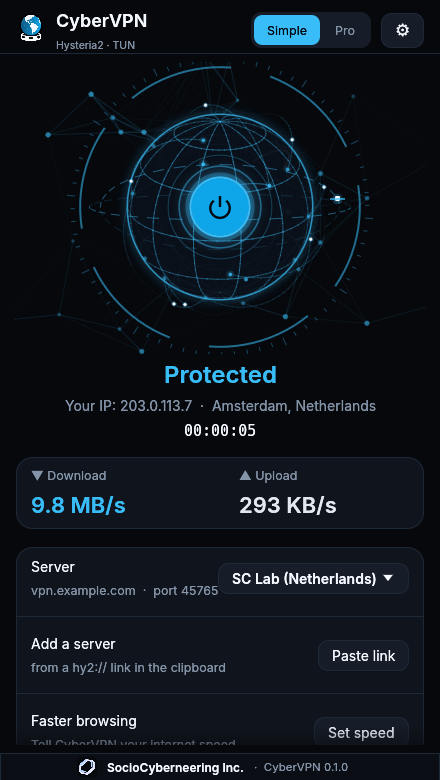
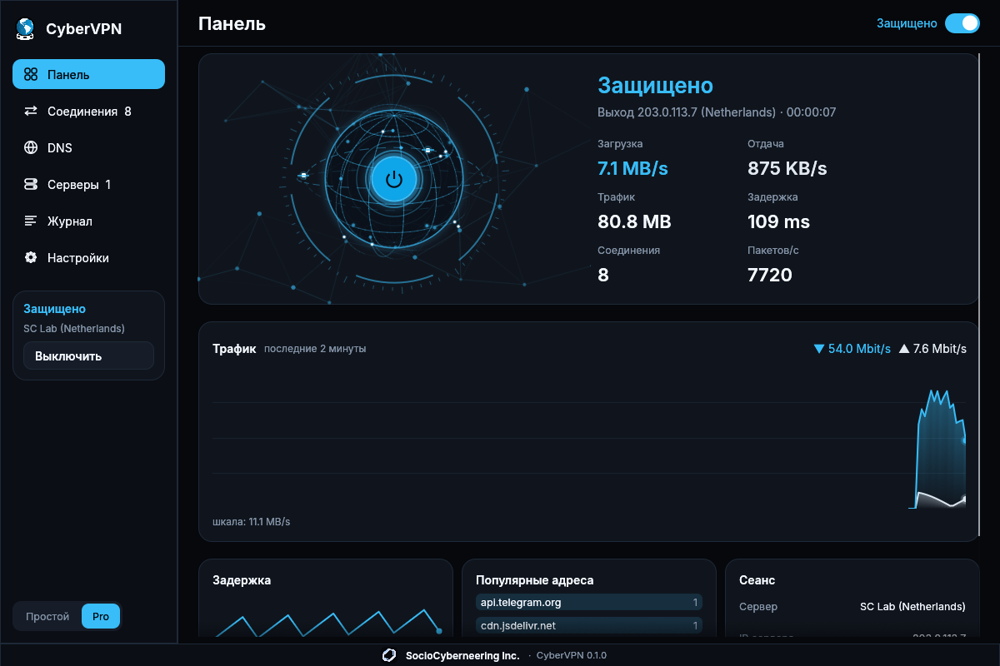

# CyberVPN

Desktop **Hysteria2** VPN for Linux and Windows, written in Rust.
Full-system VPN (TUN mode: every app goes through it), tray icon, notifications,
animated UI in a White · Sky Blue · Black style, Simple and Pro modes.

| Simple | Pro — dashboard |
|---|---|
|  |  |

More: [notToVPN settings](docs/not-to-vpn.png) · [settings](docs/pro-settings.png) · [connections](docs/pro-connections.png) ·
[servers](docs/pro-servers.png) · [icons and tray states](docs/icons.png)

© SocioCyberneering Inc.

## Features

- **Tray icon** — the SocioCyber globe: grey = off, sky ring badge = connecting,
  sky ✓ badge = protected, red ! badge = error. Menu: status, live speed, **Turn ON/OFF**,
  server switcher, Open, Quit.
- **Notifications** — connected (with your new IP and country), disconnected, reconnecting, errors.
- **Reminder** — "You are not protected" every N minutes while the VPN is off
  (Linux: with a **Turn on** button in the notification). Also at login if you don't auto-connect.
- **Autostart** — Linux (XDG `~/.config/autostart`) and Windows (registry `Run` key);
  start hidden in the tray, optionally connect automatically.
- **Simple mode** — one big animated power button, status, your IP, speed, server picker,
  "Paste link".
- **Pro mode** — dashboard (speed, data used, latency, open connections, 2-minute traffic chart,
  top destinations, session info), live **Connections** table (app · IP · domain · state),
  **DNS** log, **Servers** manager (rename, speed, delete), **Log**, full **Settings**.
- **Dark / Light** themes, smooth animations (ripples, spinning arcs, animated numbers and charts).
- **Command line / hotkeys:** `cybervpn on`, `cybervpn off`, `cybervpn toggle`
  (Hyprland: `bind = SUPER, V, exec, cybervpn toggle`).

## Language, look and animations

- **Russian / English** follows the system language automatically (`LANG`/`LC_*` on Linux,
  the UI language on Windows). Settings → Appearance → Language: Auto / English / Русский.
  The window, tray menu and notifications are all translated.
- **Style:** White · Sky Blue · Black. Light/dark follows the system or is set by hand.
- **Animations** (can be turned off): a rotating wireframe planet with network nodes,
  data packets on the arcs, orbiting satellites, a HUD ring with a scan beam while connecting,
  a drifting network background and "decrypting" status text, in a Watch Dogs-like look.
- The **Inter** font (OFL) and DejaVu Sans are bundled, so the UI looks the same everywhere.

## notToVPN: split tunneling by domain (Pro mode, Linux)

Settings → **Split tunneling — notToVPN** (off by default, visible in Pro mode only):
choose zones (`.ru .рф .su .by .kz .ua .uz .am .ge .md`) and add domains (`gosuslugi.ru`, `vk.com`…).

How it works in TUN mode, without leaking the rest:
- CyberVPN's private DNS resolves names from the list **directly** (via the "Direct DNS",
  Yandex 77.88.8.8 by default).
- Before the app gets the answer, those IPs get an `ip rule … lookup main pref 8765` that
  bypasses the tunnel.
- Everything else, including all other DNS lookups, stays in the VPN. The rules are removed
  on disconnect and after crashes.
- Limitations: sites that share an IP with a listed one (big CDNs) also go direct. Apps that
  connect to raw IPs without DNS are not matched. Requires "Private DNS through the tunnel".

## VPN engine: built in, updated automatically

- The official Hysteria core (v2.14.0, from `vendor/`, SHA-256 checked) is **built into CyberVPN**
  for Linux x86_64/arm64 and Windows x86_64. Nothing has to be downloaded, so it works even
  where GitHub is blocked.
- **Background updates** (Settings → VPN engine, on by default): every 6 hours, and 90 s after
  start, CyberVPN checks for a newer release and downloads it **next to the running engine**
  (parallel, resumable, SHA-256 checked). The VPN is never interrupted.
- The new engine **replaces the old one on the next connect or app start**, never under a
  running VPN. If the VPN is off when the download finishes, it switches right away.
- A notification says when an update is downloaded and when it was installed. Both the updates
  and the notification can be turned off. `cybervpn update-engine` checks now.
- Building with a newer bundled engine: replace the files in `vendor/` (see
  `vendor/SHA256SUMS`) and rebuild.

CyberVPN and hy2tui never run in TUN mode at the same time. The second one refuses and says
which is running. Leftovers of a crashed session are cleaned automatically.

## Stability notes

- **IPv6 auto-check.** Many VPN servers have no IPv6. Without this check, apps
  would try IPv6 first and stall: `curl` gives "Empty reply from server",
  YouTube loads slowly, and web apps keep reconnecting. After connecting,
  CyberVPN checks whether IPv6 works through the server. If it doesn't, it hides
  IPv6 addresses in DNS, so everything uses IPv4 right away. IPv6 traffic still
  can't leak past the tunnel. Settings → Pro → *IPv6*: Auto / On / Off.
- **The same engine as hy2tui:** the hysteria core v2.14.0, with the same
  config.
- **Light on CPU.** Animations run only while the window is focused. Hidden or
  minimized windows almost stop drawing, leaving the CPU to the VPN engine.
- **The tray needs no libraries.** On Linux it talks StatusNotifierItem over
  D-Bus directly (no GTK, libappindicator or libxdo). It shows in XFCE, KDE,
  Cinnamon, MATE, LXQt, waybar, and in GNOME with the AppIndicator extension.
  Left click opens the window, middle click turns the VPN on/off, right click
  opens the menu.
- **One window.** Starting `cybervpn` again brings up the open window instead
  of opening a second one.

## Install (Arch / Artix)

```sh
unzip cybervpn.zip && cd cybervpn
./install.sh          # installs deps, builds, puts cybervpn in /usr/local/bin + app menu entry
cybervpn              # or start "CyberVPN" from the app menu
```

1. Copy your `hy2://…` link → press **Paste link**.
2. Press the big button. The first time, CyberVPN downloads the official Hysteria engine
   (resumable, parallel, SHA-256 checked), then asks for your password.
3. *Settings → "Don't ask again"* installs a polkit rule, so connecting never asks again.

**Hyprland:** the password dialog needs a polkit agent (e.g. `hyprpolkitagent`) and the tray needs
a bar with a tray (waybar `tray` module).

## Windows

Build with `cargo build --release` (Rust MSVC toolchain) or download the artifact from CI
(`.github/workflows/build.yml` builds Linux + Windows; Gitea Actions uses the same file).
Connecting shows a UAC prompt (TUN, routes and DNS need administrator rights).
If the TUN adapter cannot be created, put `wintun.dll` (from wintun.net) next to
`%LOCALAPPDATA%\CyberVPN\bin\hysteria.exe`.

> The Windows build is **not tested yet**: the code is written and checked against the
> windows-sys API, but it was not compiled on Windows. Run the CI workflow first.

## How it works

```
 window (egui, user)  ⇄  tray service (user)  ⇄  backend (root/admin)  →  hysteria core (TUN)
         local TCP + random token          pkexec / UAC
```

- **Window** — only displays snapshots (4× per second) and sends commands. Closing it keeps
  CyberVPN in the tray. This also works on Wayland, where windows cannot be hidden.
- **Tray service** — owns config, tray, notifications, reminders, history for charts.
- **Backend** — the only privileged part: starts the core in TUN mode, routes all IPv4 + global
  IPv6 through it (server IP and LAN excluded), points DNS at a small forwarder that sends queries
  through the tunnel and logs them, tunes UDP buffers. If the service disappears, the backend
  stops and restores DNS and sysctl.

Files: `~/.config/cybervpn/config.toml` (mode 600), engine in `~/.local/share/cybervpn/bin/`.
On Windows: `%APPDATA%\CyberVPN` and `%LOCALAPPDATA%\CyberVPN`.

## Faster than nekoray

Set your real line speed per server (**Speed** button / "Set speed" tip). CyberVPN then uses
Hysteria's **Brutal** congestion control instead of BBR. On Linux it also raises UDP socket
buffers to 16 MiB (QUIC is limited by the ~208 KiB default) and uses the core's own TUN.

## Demo mode

`CYBERVPN_DEMO=1 cybervpn` — simulated traffic, no root, no network changes.
Used for the screenshots above.

## Troubleshooting

- *"Permission denied"* — the password dialog was cancelled or no polkit agent is running.
- *No tray icon* — your panel needs StatusNotifier/AppIndicator support (waybar `tray`).
- *Internet broken after a crash* — run `cybervpn on` then `cybervpn off`, or restore
  `/etc/resolv.conf` from `/var/lib/cybervpn/resolv.conf.bak`.
