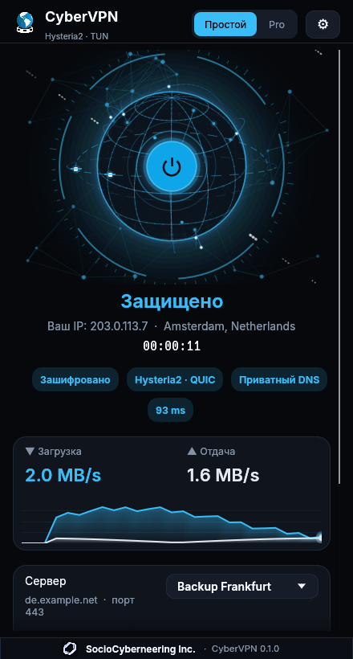
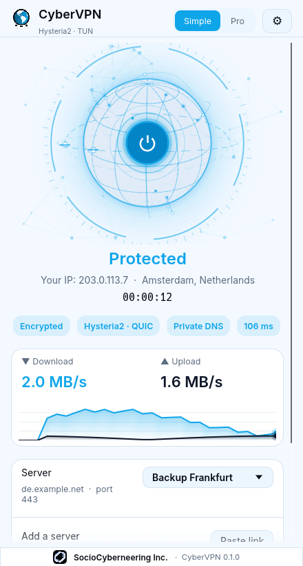
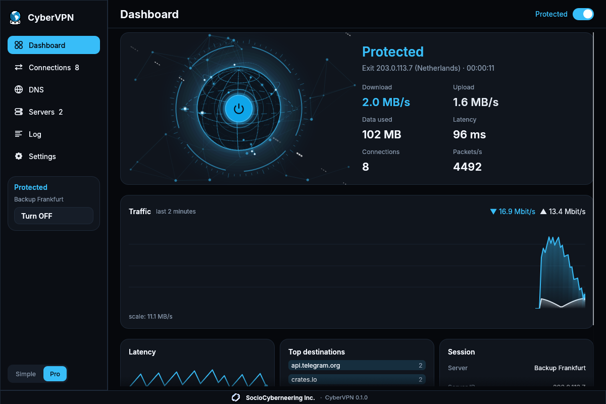
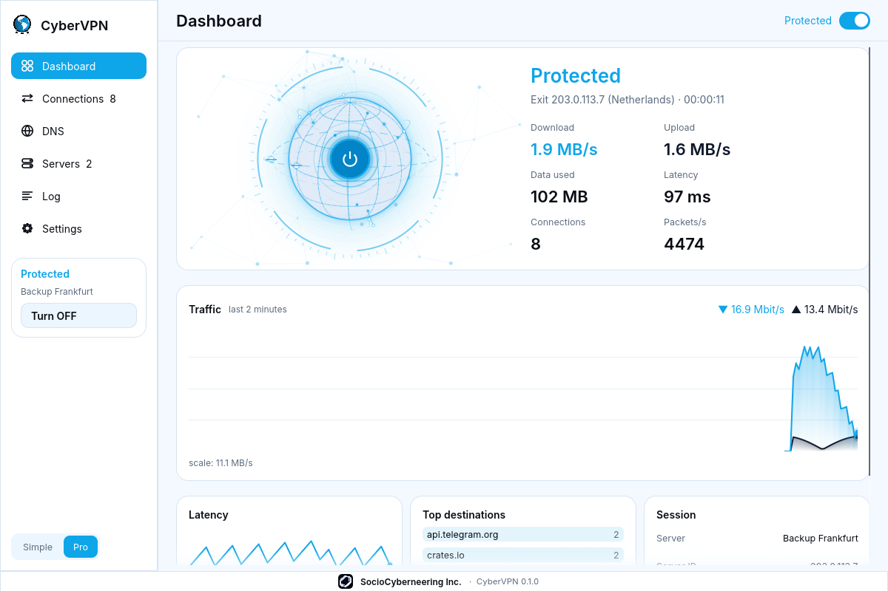

<div align="center">


# CyberVPN

**Быстрый и красивый VPN на Hysteria2 для Linux и Windows, написан на Rust.**
Одна кнопка. Иконка в трее. Права root не нужны.

[English](README.md) · **Русский**

[](https://github.com/sociocyber1/CyberVPN/actions/workflows/build.yml)
[](https://github.com/sociocyber1/CyberVPN/releases/latest)
[](LICENSE)


&nbsp;&nbsp;

</div>

## Почему CyberVPN

- **Одна кнопка.** Вставьте ссылку `hy2://` (или возьмите бесплатные серверы SocioCyberneering) и нажмите на глобус.
- **Без root и без пароля.** В режиме «Авто» браузеры и программы защищены через системный прокси. Режим «Вся система» (TUN) включается одним нажатием.
- **Быстро.** Официальный движок Hysteria2 поверх QUIC, кеш DNS с параллельными запросами, Brutal и большие UDP-буферы.
- **Сам держит связь.** Переподключается после смены Wi-Fi и чинит пропавший TUN или «мёртвую» связь. Если у сервера нет IPv6, IPv6-адреса скрываются, чтобы сайты не зависали.
- **Красиво.** Анимированная планета, живые графики скорости, тёмная и светлая темы. Язык (русский или английский) берётся из системы.

## Скачать

Последняя сборка лежит в **[Releases](https://github.com/sociocyber1/CyberVPN/releases/latest)**:

| Система | Файл |
|---|---|
| Linux x86_64 | `cybervpn-linux-x86_64` |
| Windows x86_64 | `cybervpn-windows-x86_64.exe` |

```sh
chmod +x cybervpn-linux-x86_64
sudo install -m755 cybervpn-linux-x86_64 /usr/local/bin/cybervpn
cybervpn
```

VPN-движок (hysteria v2.14.0) **встроен** в программу, поэтому доступ к GitHub не нужен. На Linux из зависимостей нужен только `polkit`, и только для режима «Вся система». Трею никакие библиотеки не нужны.

## Режим Pro




В режиме Pro есть дашборд с трафиком, задержкой и популярными адресами, а также страницы с живыми соединениями по программам и доменам, журналом DNS, серверами и логами. В его настройках есть DNS-серверы, TUN, notToVPN и обновления движка.

## Возможности

| | |
|---|---|
| 🌍 **Бесплатные серверы** | При первом запуске CyberVPN скачивает открытые ключи SocioCyberneering и выбирает случайный. **Настройки → Обновить** обновляет список. |
| 🔓 **Режимы VPN** | **Авто** (никогда не спрашивает пароль) · **Вся система** (TUN, все программы и DNS) · **Прокси** (`127.0.0.1:2080`, SOCKS5 + HTTP, системный прокси включается сам) |
| 🧭 **notToVPN** | Зоны и домены (`.ru`, `.kz`, `gosuslugi.ru`…) идут напрямую, всё остальное остаётся в туннеле, без утечек DNS. |
| ⚡ **Быстрый DNS** | Кеш по TTL, параллельные запросы по UDP и постоянному TCP, побеждает первый ответ. Зависаний DNS на 5–13 с больше нет. |
| 🛡 **Сторож сети** | Переподключение при смене сети, пропавшем TUN или «мёртвой» связи. При запуске ждёт появления сети. |
| 🔁 **Обновление движка** | Скачивается в фоне и применяется при следующем подключении, не прерывая VPN. |
| 🔔 **Трей** | Быстрое вкл/выкл, смена сервера, скорость в меню, уведомления и напоминание «VPN выключен». Работает через D-Bus напрямую: XFCE, KDE, Cinnamon, MATE, LXQt, waybar. |
| 🚀 **Автозапуск** | Linux (XDG) и Windows. |

## Режимы VPN

| Режим | Что идёт через VPN | Пароль |
|---|---|---|
| **Авто** (по умолчанию) | Вся система, если для этого не нужен пароль, иначе прокси | никогда |
| **Вся система** | Все программы и DNS (TUN) | спрашивается, если вы один раз не включили «Не спрашивать пароль» |
| **Прокси** | Браузеры и программы, использующие системный прокси | никогда |

В режиме прокси программы, которые игнорируют системный прокси (некоторые игры и консольные утилиты), не защищены. Для них используйте `curl -x socks5h://127.0.0.1:2080 …` или переключитесь на «Вся система».

## Сборка из исходников

```sh
git clone https://github.com/sociocyber1/CyberVPN && cd CyberVPN
./install.sh        # Arch/Artix: polkit, сборка, /usr/local/bin и пункт в меню
# или просто:
cargo build --release
```

`CYBERVPN_DEMO=1 cybervpn` запускает приложение с имитацией трафика, без root и без изменений в сети. Скриншоты выше сделаны так.

## Как устроено

```
 окно (egui)  ⇄  служба в трее (пользователь)  ⇄  backend (root, только для TUN)  →  ядро hysteria
          локальный TCP + случайный токен             pkexec / UAC
```

- **Окно:** только показывает данные и отправляет команды. Если его закрыть, CyberVPN остаётся в трее.
- **Служба в трее:** хранит настройки, отвечает за трей, уведомления и графики. Режим прокси целиком работает здесь, от имени пользователя.
- **Backend:** единственная привилегированная часть. Поднимает TUN, направляет через туннель весь IPv4 и глобальный IPv6 (кроме сервера и локальной сети), запускает приватный DNS и сторожа сети, а при остановке всё возвращает.

Файлы: настройки в `~/.config/cybervpn/config.toml` (права 600), движок в `~/.local/share/cybervpn/bin/`, логи в `~/.cache/cybervpn/`.

## Если что-то не так

- **Ничего не открывается:** запустите `cybervpn` в терминале и посмотрите `~/.cache/cybervpn/*.log`.
- **Нет иконки в трее:** панели нужна поддержка StatusNotifier (системный трей XFCE, KDE, модуль `tray` в waybar).
- **«Permission denied»:** окно пароля закрыли, или не запущен polkit-агент.
- **Пропал интернет после сбоя:** запустите CyberVPN снова. При запуске он восстанавливает DNS и настройки прокси.

## Родственный проект

**[hy2tui](https://github.com/sociocyber1/hy2tui)** — тот же движок в виде быстрого консольного приложения с дашбордом в стиле btop.

## О SocioCyberneering Inc.

▶ [Видео о проекте](https://youtu.be/258cx_PsrRA?t=1360) · контакты: в приложении, раздел «О SocioCyberneering Inc.»

**Поддержать автора.** Если вы считаете эту работу полезной — можно помочь деньгами. Коротко, без драматургии: автор делает всё сам, из своего кармана и бесплатно, а подписки, инструменты, серверы и время на них расходуются вполне материально. Ваша поддержка помогает поддерживать проект и серверы в рабочем состоянии.

Карта Сбер: `2202 2081 1034 0461`

---

<sub>GPL-3.0 · сделано SocioCyberneering Inc.</sub>
